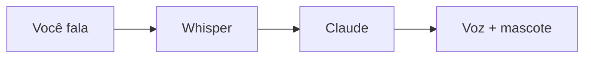

---
atualizado:
assunto: (o Claude reescreve esta nota inteira quando algo se entende melhor vendo)
---

# Visor

A casa da Sexta mostra esta nota. Cada seção `##` vira um quadro que ela aponta durante a fala, na marca `{seção N}`.

## Exemplo

